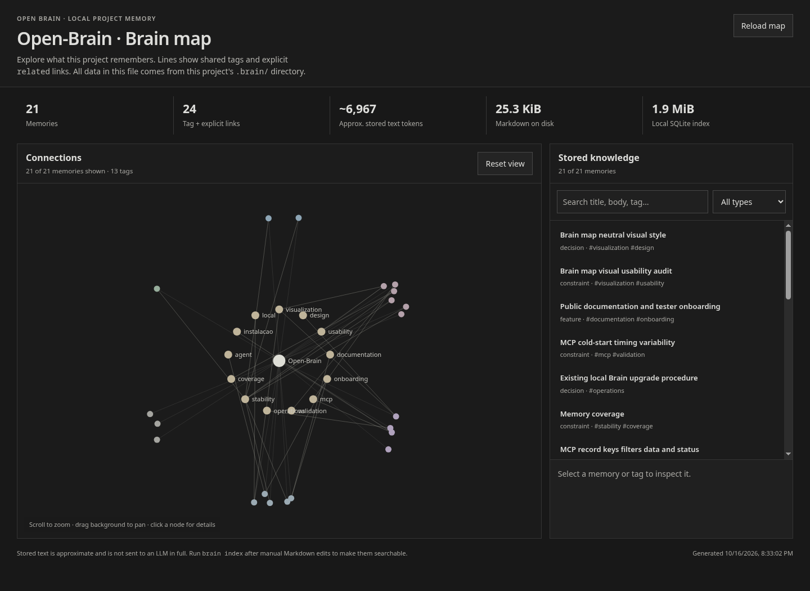
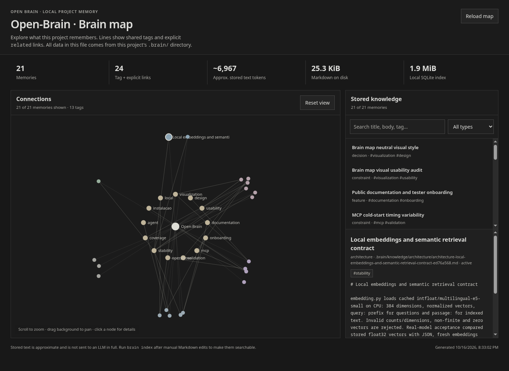
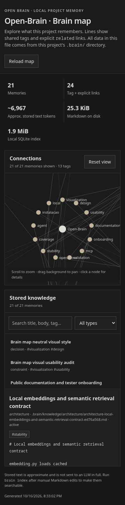

# Open Brain

**Memória local e persistente para agentes de programação.** Guarde decisões,
arquitetura, regras e próximos passos em Markdown. Recupere o contexto relevante
por busca semântica quando uma tarefa ou uma nova sessão precisar dele.

[English](README.md) · **Português brasileiro**

[](https://github.com/Vini-create/Open-Brain/actions/workflows/ci.yml)
[](LICENSE)

O produto é uma CLI (`brain`) e um servidor MCP via stdio. Os embeddings são
gerados localmente na CPU. O uso local **não exige chave de API de LLM, banco
hospedado ou GPU**. A instalação e o primeiro download do modelo público precisam
de internet; depois, a indexação e a busca locais usam o modelo em cache.

**Versão inicial (0.1.0), aberta a testes e feedback.** A instalação nativa foi
validada em Linux x86_64. Há instruções para outros sistemas, com os limites de
validação indicados no [guia de instalação](docs/INSTALLATION.md#choose-your-operating-system), em inglês.

## Para que serve

- Preservar conhecimento do projeto entre sessões, sem depender do histórico do chat.
- Buscar fatos pelo significado, com perguntas em português ou inglês.
- Manter memórias legíveis e versionáveis em `.brain/`, dentro de cada projeto.
- Dar ao agente acesso por MCP ou por comandos no terminal.
- Mostrar o que foi salvo num mapa local, aberto pelo navegador.

O agente precisa selecionar e salvar o conhecimento. O Open Brain não lê todo o
repositório sozinho nem registra toda conversa automaticamente. O agente continua
precisando conferir o código e rodar os testes apropriados.

[Veja o mapa](#como-o-brain-aparece-para-você) · [Instalação](#1-instale-uma-vez) ·
[Primeiro teste](#2-faça-o-primeiro-teste) · [Conexão com o agente](#4-conecte-ao-agente)

## 1. Instale uma vez

No **Linux**, com Git, Bash e Python 3.10+ com `venv` disponíveis:

```bash
cd ~
git clone https://github.com/Vini-create/Open-Brain.git
cd Open-Brain
bash scripts/install.sh
export PATH="$HOME/.local/bin:$PATH"
brain --help
```

O instalador cria o ambiente Python no clone, instala as dependências, baixa o
modelo público e disponibiliza `brain` em `~/.local/bin`. Também ajusta os arquivos
de inicialização dos shells suportados. O `export` vale para o terminal Bash/Zsh
atual. Mantenha o clone no lugar: o comando e a configuração MCP usam esse caminho.
Só clonar o repositório não instala o comando. Os downloads de PyTorch e do modelo
podem demorar e ocupar espaço em disco.

Instruções detalhadas: [Linux](docs/INSTALLATION.md#linux),
[macOS](docs/INSTALLATION.md#macos-apple-silicon),
[Windows PowerShell](docs/INSTALLATION.md#windows-powershell),
[WSL2](docs/INSTALLATION.md#windows-with-wsl2) e
[Docker](docs/INSTALLATION.md#docker). O instalador Bash não roda nativamente no
PowerShell. Esses guias técnicos estão em inglês.

## 2. Faça o primeiro teste

Use uma pasta de demonstração para estes fatos de exemplo:

```bash
mkdir -p ~/open-brain-demo
cd ~/open-brain-demo
brain init
brain remember --type rule --title "Expiração de sessões" --content "Sessões inativas expiram após 37 minutos. Sessões fixadas nunca expiram." --tag sessoes
brain search "Quando uma sessão sem atividade é encerrada?" --token-budget 500
brain status
brain map
```

A busca deve recuperar **37 minutos**. O status deve mostrar uma memória salva,
`indexed_chunks` e `indexed_vectors` iguais e `"index_consistent": true`.
Logo depois de `brain init`, ter zero memórias é normal.

Abra `.brain/map.html` no navegador para inspecionar o conteúdo salvo. O mapa
funciona offline. `brain map` atualiza a visualização; `brain index` sincroniza
as memórias editadas manualmente. A próxima busca também verifica mudanças.

## 3. Use no seu projeto

```bash
cd /caminho/absoluto/do/seu-projeto
brain init
```

Cada projeto ganha um Brain independente. O cache do modelo público é
compartilhado, mas as memórias, o índice, o histórico e o mapa ficam no projeto.

Preencha `.brain/project/idea.md`, `overview.md` e `goals.md` com fatos confirmados
e rode `brain index`. Em um projeto existente, peça ao agente para auditar os
módulos e fluxos principais e salvar conhecimentos específicos. Só um resumo da
arquitetura não garante que os detalhes necessários sejam recuperáveis.

## 4. Conecte ao agente

O MCP (Model Context Protocol) permite que um cliente compatível disponibilize
as operações do Brain como ferramentas para o agente. A configuração é feita
no cliente em que você usa esse agente:

1. Rode `brain init` dentro do projeto.
2. Abra `.brain/mcp.json`: ele contém o executável e os caminhos corretos da instalação.
3. Se o cliente lê `.mcp.json` na raiz, use o arquivo gerado. Caso contrário,
   copie `command` e `args` para as configurações de **MCP via stdio** do cliente,
   adaptando o formato de configuração.
4. Reinicie a conexão MCP ou o cliente. Confirme que `brain_status`, `brain_search`
   e `brain_remember` estão disponíveis.
5. Peça ao agente para salvar um fato de teste e recuperá-lo numa sessão nova.

O arquivo `AGENTS.md` aponta para `.brain/AGENT_BRAIN.md`. O servidor MCP também
envia esse protocolo na inicialização. A entrega das instruções depende do cliente;
gerar uma configuração não comprova que o agente está usando a memória.

Você pode começar com este pedido:

> Leia `.brain/AGENT_BRAIN.md`. Antes desta tarefa, consulte o Brain pelo contexto
> relevante e confira os detalhes de implementação no código. Após mudanças
> importantes, atualize as memórias com o que mudou, por quê, os testes realmente
> executados e as pendências. Confirme a recuperação com uma pergunta reformulada.
> Se o MCP não estiver disponível, use `brain search` e `brain remember` no terminal
> do projeto.

Sem MCP, um agente com acesso ao terminal pode usar os mesmos comandos da CLI.
Rode dentro do projeto ou passe `--project /caminho/absoluto/do/projeto`.
Consulte as chamadas do agente ou os logs `.brain/history/searches.jsonl` e
`changes.jsonl` para verificar uso real. Nenhum arquivo de instruções obriga
todos os agentes externos a seguir a rotina.

## Como o Brain aparece para você

Esta é uma captura real do mapa das memórias públicas do próprio Open Brain:



Depois de salvar os primeiros fatos úteis, o protocolo orienta o agente a rodar
`brain map`, mostrar o caminho completo e abrir `.brain/map.html` no navegador ou
preview HTML local, quando disponível. Se não puder abrir, ele informa o arquivo
para você. **Não precisa subir servidor local, hospedar nem criar conta:** basta
abrir o HTML da pasta do projeto. O comando também mostra onde ele foi gerado.

Clique numa memória para ler conteúdo, tags e origem. A busca do mapa é textual;
a busca semântica está na CLI/MCP. O HTML é uma captura gerada dos dados: rode
`brain map` e use **Reload map** para atualizar. O agente apresenta o mapa durante
a adoção inicial e após atualizações importantes, sem abrir uma aba a cada gravação.

<details>
<summary>Ver leitura de uma memória e versão em tela pequena</summary>





</details>

Os prints estão em [`docs/images/`](docs/images/README.md), dentro do repositório,
para aparecerem no GitHub. O `.brain/map.html` de cada usuário continua local e
ignorado pelo Git, pois contém as memórias do projeto dele.

## Comandos do dia a dia

| Comando | Função |
| --- | --- |
| `brain remember --type decision --title "Assunto" --content "Fato confirmado"` | Salvar e indexar conhecimento. |
| `brain search "pergunta" --token-budget 500` | Recuperar contexto relevante. |
| `brain search "pergunta" --tag auth --json` | Filtrar por tag e ver resultados estruturados. |
| `brain status` | Conferir contagens e consistência dos vetores. |
| `brain index` | Sincronizar Markdown novo, alterado ou removido. |
| `brain rebuild` | Reconstruir o índice a partir dos Markdown. |
| `brain map` | Atualizar o mapa offline. |
| `brain model download` | Baixar o modelo público para o cache local. |

Salvar novamente o mesmo tipo e título atualiza a memória e mantém a versão
anterior no histórico local. Use `--key` se precisar manter a identidade mesmo
mudando o título. Veja as opções com `brain --help` e `brain <comando> --help`.

## Dúvidas comuns

| Situação | O que fazer |
| --- | --- |
| `brain` não é encontrado | Abra um terminal novo ou ajuste o PATH. Veja [instalação e shell](docs/INSTALLATION.md#make-the-unix-command-available-in-new-terminals). |
| Modelo indisponível localmente | Rode `brain model download` num projeto inicializado, com internet. |
| O agente não usa a memória | Confira as ferramentas MCP ou o acesso à CLI, o carregamento das instruções e as chamadas/logs. |
| A busca não trouxe um detalhe | Confirme que ele foi salvo, rode `brain index` e faça uma pergunta mais específica ou aumente o orçamento. |
| `index_consistent` está falso | Rode `brain rebuild` e confira o status. Os Markdown são a fonte de verdade. |
| A primeira busca demora | Um processo novo carrega o modelo. CPU, disco e quantidade de memórias afetam o tempo. |

Para atualizar a instalação, siga o [procedimento de atualização](docs/INSTALLATION.md#update-an-existing-installation).
Depois, rode `brain init` e `brain index` nos projetos existentes e reinicie as
conexões MCP abertas.

## Resultados e limites

O [relatório de estabilidade](STABILITY_REPORT.md) registra a validação de
embeddings reais, persistência, concorrência, recuperação após falhas e MCP.
A suíte final passou 33 testes, com um ignorado por falta do Fish. Um timeout
anterior na inicialização e plataformas não verificadas também estão documentados.

Na avaliação detalhada com fatos escritos para o teste, 12/12 perguntas
recuperaram todos os fatos esperados com orçamento de 500 tokens estimados.
Com apenas 180, duas respostas perderam detalhes. A busca retorna o melhor trecho
por memória; prefira assuntos independentes e perguntas específicas.

As economias de contexto publicadas no [README em inglês](README.md#historical-token-savings-measurements)
comparam cenários específicos de recuperação. Não são uma medição da conta total
de LLM nem uma garantia de produtividade. Os [benchmarks](docs/BENCHMARKS.md)
explicam os dados, as premissas e as limitações.

## Compartilhamento e feedback

As memórias são arquivos do seu projeto. Se quiser compartilhá-las com a equipe,
versione os Markdown e as instruções portáveis. Índice, histórico, mapa e
configurações MCP com caminhos locais ficam no `.gitignore` gerado. Revise o
conteúdo antes de publicar: as memórias podem conter informações do projeto.
[Veja o que versionar](docs/INSTALLATION.md#what-to-commit-in-your-project).

Para testar, salve um fato, reinicie o agente e tente recuperá-lo com outra
formulação. Se houver problema, compartilhe sistema/arquitetura, versão do Python,
comando, resultado esperado e saída obtida. Para problemas de busca, inclua um
exemplo sem informações privadas, a pergunta e o orçamento usado.

[Reportar problema ou resultado de teste](https://github.com/Vini-create/Open-Brain/issues/new/choose) ·
[Contribuir](CONTRIBUTING.md) · [Documentação completa](README.md#documentation) ·
[Licença MIT](LICENSE)

A [integração remota](docs/REMOTE.md) é opcional, exige um serviço compatível
separado e não faz parte do fluxo local descrito acima.
