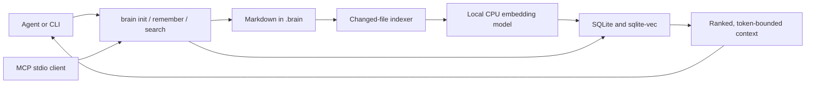

# Architecture

Open Brain stores **durable project knowledge**, not the whole repository or a conversation dump. Markdown is canonical. A local SQLite database is a disposable index. A CPU embedding model and `sqlite-vec` provide semantic distance; keyword matching, importance, and recency also affect ranking. This guide describes the standalone local path; [optional linked-service behavior](REMOTE.md) has different network and sync boundaries.



## Repository layout

| Path | Responsibility |
| --- | --- |
| `src/second_brain/cli.py` | CLI commands and user-facing output. |
| `src/second_brain/core.py` | Project initialization, memory writes, hybrid ranking, response budget. |
| `src/second_brain/documents.py` | Markdown and YAML front matter parsing, document IDs, chunks. |
| `src/second_brain/embedding.py` | Local CPU model loading, explicit download, query and passage vectors. |
| `src/second_brain/storage.py` | SQLite schema, `sqlite-vec`, incremental index, rebuild, status. |
| `src/second_brain/mcp.py` | JSON-RPC over stdio: `brain_search`, `brain_remember`, `brain_status`. |
| `src/second_brain/mcp_tools.py` | MCP tool schemas, dispatch, text rendering and recoverable tool errors. |
| `src/second_brain/locking.py` | Per-project serialization of canonical writes and index rebuilds. |
| `src/second_brain/remote.py` | Standalone backend plus optional HTTP client, queued writes and mirror. |
| `src/second_brain/visualization.py` and `assets/brain_map.html` | Build an offline, interactive view from one project's Markdown. |
| `scripts/brain-docker` and `Dockerfile` | Optional container execution with host project and model-cache mounts. |
| `benchmarks/` and `tests/` | Reproducible measurements, analytical scenarios, and automated checks. |

## Generated project layout

```text
your-project/
├── AGENTS.md                  # tells agents to read the Brain protocol
├── .mcp.json                  # local MCP command; ignored by Git
└── .brain/
    ├── AGENT_BRAIN.md         # when agents should search and remember
    ├── PROJECT_COVERAGE.md    # detailed onboarding audit; read when needed
    ├── README.md              # local instructions
    ├── config.json            # embedding model, search weights, storage path
    ├── project/               # idea.md, overview.md, goals.md
    ├── knowledge/             # structured durable memories by type
    ├── index/brain.db         # rebuildable SQLite index; ignored by Git
    ├── history/               # versions and search log; ignored by Git
    ├── map.html               # generated, interactive local view; ignored by Git
    └── mcp.json               # local MCP command; ignored by Git
```

`brain init` is safe to rerun: it does not overwrite populated project templates or custom `AGENTS.md` rules. It refreshes local MCP paths and adds missing agent-protocol sections. It creates an empty index without loading the model. A supplied `--idea` is indexed immediately and therefore requires a downloaded model.

## Write and retrieval flow

1. `brain remember` validates a type, title, content, tags, and importance, then writes a Markdown file with YAML front matter. The type and title form a stable identity so updates replace the same memory. Previous versions are kept locally.
2. `brain index` compares Markdown hashes with the database, embeds only changed chunks, removes deleted documents, and leaves unchanged vectors alone. `brain rebuild` recreates the index from Markdown.
3. `brain search` first checks all Brain Markdown files for changes, embeds the query locally, computes vector similarity, combines it with keyword, importance, and recency scores, and returns ranked excerpts within an approximate token budget.
4. The MCP server exposes the same search and write operations to a compatible client. It has no network listener or LLM dependency.
5. `brain init`, `brain remember`, and any indexing change regenerate `.brain/map.html`. `brain map` refreshes it directly from canonical Markdown without loading the embedding model. The page embeds its own data and scripts and does not contact a server. It shows shared-tag and explicit-`related` links; hub lines mean project membership, not semantic similarity.

Canonical writes and indexing share a reentrant per-project file lock across
threads and processes. Each incremental index update commits documents, chunks
and vectors in one SQLite transaction. Duplicate Markdown IDs are rejected;
renaming or swapping paths preserves identity. Rebuild writes a sibling temporary
database and replaces the live index only after success. A failed embedding leaves
the last index intact; searches retry synchronization and report the error until
the underlying problem is resolved. Markdown remains canonical if saving succeeds
but indexing fails, so a later `brain index` can recover it.

Search reads scores and chunks in one database snapshot and rejects missing or
orphaned vectors with a rebuild instruction. Status exposes counts and consistency.
Ignored history directories are recreated on use, including in fresh clones.
Embeddings must have the configured dimension, one vector per input, finite
components and nonzero length. The default encoder normalizes query/passages and
uses E5's respective `query:` / `passage:` prefixes.

Local MCP supports tag filters and optional stable record keys across title
changes. `brain_record` persists `data` in YAML; `brain_get` returns it. Without
an explicit key, type/title remains the identity used by `brain_remember`.

### Detailed retrieval

Passages have a maximum of 850 characters with approximately 100 characters
of overlap, preferring paragraph/sentence boundaries. Embeddings include the
memory title and tags. A versioned index format re-embeds existing Markdown
once after an upgrade; subsequent indexing remains incremental. Markdown and
user instructions are preserved.

English and Portuguese common words are excluded from keyword coverage. Vector
scores are scaled between the lowest and highest cosine similarities in the
filtered candidate set before combining the configured ranking weights. Scores
are relative rankings within a query, not confidence probabilities and not
comparable across queries or corpora. With budgets of at least 350 estimated
tokens, space is reserved for up to three memories; shorter budgets favor the
first result. Truncated excerpts prefer sentence windows matching the query
instead of always returning the document introduction.

Search still returns the best passage per document and does not perform an
LLM reranking step. Multi-part questions can require multiple focused searches.
The agent's detailed coverage checklist records contracts, state transitions,
failure cases, source paths and validation, then checks paraphrased retrieval.
Saving a general overview alone does not capture these details automatically.

The default model is `intfloat/multilingual-e5-small` with 384-dimensional vectors.
The installer and `brain model download` explicitly fetch public weights. Normal
indexing/search use cached files with the default `local_files_only: true` setting;
setting it to false can allow the model loader to access the network. No project
content is sent to an embedding API in the standalone path.

## Index choice and scaling

The current index stores metadata and vectors in one local SQLite database. [`sqlite-vec`](https://github.com/asg017/sqlite-vec) supplies vector storage and cosine-distance functions. [FAISS](https://github.com/facebookresearch/faiss/wiki/guidelines-to-choose-an-index) offers specialized indexes that may be useful at much larger vector counts. For this V1, keeping Markdown and a rebuildable SQLite index is simpler to install and maintain.

Hybrid ranking currently computes a vector distance and score for **every indexed chunk**. This avoids the `vec0` KNN query's `k` limit of 4,096, but search cost grows with memory count. The empirical benchmark includes 10,000 project documents and 10,000 corresponding indexed memories; projections above that size are token-payload arithmetic only and do not demonstrate acceptable latency or recall. An approximate nearest-neighbor index would require a measured quality and maintenance tradeoff before adoption.

## Boundaries

- The standalone path has no automatic repository scan, Git hook, file watcher, background daemon or cloud sync. Optional linking/sync is documented separately.
- The agent must decide what durable facts to record. New source-code changes are not searchable until relevant knowledge is written to `.brain/`.
- A retrieved memory is project context, not proof that code still matches it. Agents should verify source files before edits.
- The token budget uses a local approximation of three characters per token; benchmark reports count output with `cl100k_base` and disclose the difference.
- The map's stored-token estimate uses the same rough three-characters-per-token rule. It is not the number of tokens sent to an LLM. The graph draws at most 180 matching memories at once, while its list can search every stored memory.
- Every project owns its own `.brain/` Markdown, index, history, and map. The installation cache shares only public model weights. Closing a process does not remove project data.
